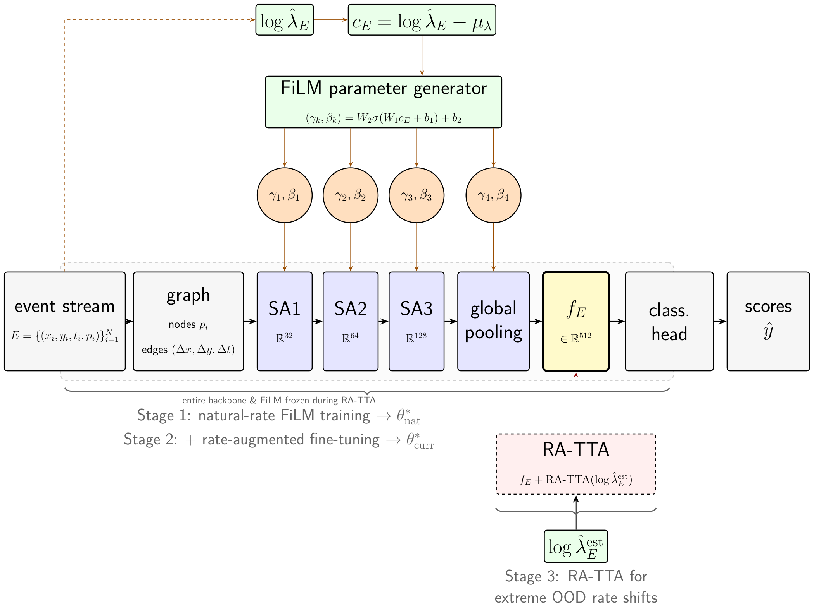

# CEGNN: Curriculum-FiLM Event GNN

Code, trained models and raw results for *Rate as a Feature, Not a Nuisance: Curriculum FiLM Training for Event-Based Graph Neural Networks*.

Paper: [arXiv:2610.26933](https://arxiv.org/abs/2610.26933) ([PDF](https://arxiv.org/pdf/2610.26933))

An event camera produces events at a rate that depends on scene motion, object texture, lighting and the
sensor's own settings. On N-Caltech101, which was recorded with a single camera, the per-recording rate
spans roughly 26x and differs from class to class. Most event-GNN pipelines either rescale every
recording's timestamps into a fixed window, which removes the rate before the network ever sees it, or
train for rate invariance, which buys robustness to synthetic speed changes at the price of accuracy on
real recordings.

CEGNN keeps the rate and uses it. The log event rate of each recording drives FiLM layers placed after
every set-abstraction stage of a PointNet++ backbone. The FiLM layers are initialised to the identity, so
training starts from the plain baseline. Training has two stages: natural event rates first, then
fine-tuning with rate augmentation, starting from the stage-1 weights.

<p align="center"></p>

## Results

Top-1 accuracy with the same backbone, schedule and preprocessing everywhere. "Natural" is the test set as
recorded, averaged over seven equal-count buckets of event rate. "Synthetic" rescales the test timestamps
by 1/8x to 8x and averages over the seven factors. Full tables (including worst-bucket and worst-factor
numbers) are in [`results/SUMMARY.md`](results/SUMMARY.md), rebuilt from the CSVs with `make summary`.

Natural-rate accuracy (mean over buckets):

| Dataset | Baseline | + Rate-FiLM | + Rate-FiLM, curriculum | Gain |
|---|---:|---:|---:|---:|
| DVS128 Gesture | 68.6 | 71.2 | 82.5 | +14.0 |
| N-Caltech101 | 60.9 | 64.4 | 67.2 | +6.3 |
| CIFAR10-DVS | 51.5 | 53.2 | 56.6 | +5.2 |
| DVS-Lip | 16.5 | 17.6 | 17.1 | +0.6 |
| N-Cars | 93.9 | 93.6 | 93.5 | -0.5 |

Synthetic-rate accuracy (mean over factors):

| Dataset | Baseline | + Rate-FiLM | + Rate-FiLM, curriculum |
|---|---:|---:|---:|
| DVS128 Gesture | 34.2 | 35.0 | 63.4 |
| N-Caltech101 | 16.1 | 20.4 | 50.3 |
| CIFAR10-DVS | 19.7 | 20.0 | 42.0 |
| DVS-Lip | 3.6 | 3.7 | 9.7 |
| N-Cars | 84.9 | 78.9 | 87.9 |

The extra cost is 49K parameters (163K to 212K for the N-Caltech101 model).

How we read these numbers. The natural-rate gain is large where the event rate carries information about the
class and absent where it does not: the share of log-rate variance that lies between classes is 0.000 for
N-Cars, 0.133 for CIFAR10-DVS, 0.374 for N-Caltech101 and 0.438 for DVS128 Gesture
([`rate_label_leakage.py`](scripts/analysis/rate_label_leakage.py)). On N-Cars the curriculum still helps
under synthetic shifts (worst case 61.7 to 73.5). DVS-Lip is a null result. Controls on N-Caltech101 rule out
the cheap explanations: a baseline with a wider head (+44K parameters) gains 1.1 points, FiLM applied only after
global pooling gains nothing, and FiLM trained from scratch with rate augmentation reaches 61.7, so it is the
warm start that matters. The failed alternatives are collected in
[`docs/NEGATIVE_RESULTS.md`](docs/NEGATIVE_RESULTS.md).

Other backbones (natural-rate accuracy; details in [`ports/`](ports/README.md)):

| Backbone | Dataset | Baseline | Curriculum |
|---|---|---:|---:|
| PointNet++ | N-Caltech101 | 60.9 | 67.2 |
| EventMamba | DVS128 Gesture | 67.4 | 74.1 |
| AEGNN | N-Caltech101 | 39.2 | 38.7 |

The recipe carries over to EventMamba and did not help AEGNN in our full-length run.

## Things to know before comparing against these numbers

* **No validation split.** None of the datasets is split three ways. The test split also serves as the
  validation set: the reported checkpoint is the epoch with the best test accuracy, and early stopping
  watches it. Every method, baselines included, is treated the same way, so the comparisons between rows are
  fair, but absolute accuracies are somewhat optimistic.
* **Evaluation is stochastic.** The backbone uses farthest-point sampling with a random start. Re-evaluating
  the same checkpoint moves N-Caltech101 accuracy by about a point and DVS128 Gesture (264 test
  recordings) by a few points. `eval_natural_rates.py --repeats 5` averages this out. The orderings in the
  tables above held in every pass we ran. See [`docs/REPRODUCING.md`](docs/REPRODUCING.md#3-evaluation-noise).
* **One training run per model.** The shipped results are single runs with seed 42.
* **Naming.** The paper calls the test-time adapter RA-TTA; the code calls it `rptta` (rate-prompt TTA).

## Setup

Python 3.8 with PyTorch 1.11 and PyG 2.0.4. These versions are old on purpose, since the checkpoints and
numbers come from them.

```bash
conda env create -f environment.yml
conda activate cegnn
pip install -e .
export CEGNN_DATA_ROOT=/path/to/datasets    # raw data goes in, processed graphs come out
make test                                   # 17 unit tests, no data needed
```

## Using it

Load a trained model:

```python
from cegnn.config import load_config
from cegnn.utils import load_checkpoint

cfg = load_config("configs/dvsgesture.yaml", make_results_dir=False)
model = load_checkpoint("checkpoints/dvsgesture/film_rate_curriculum.ckpt", cfg).eval()
```

Reproduce one dataset (needs a GPU; preprocess, train the three models, evaluate):

```bash
bash scripts/run_pipeline.sh dvsgesture      # or ncaltech101, cifar10dvs, ncars, dvslip
```

The ablations and the test-time adapter have their own drivers, `scripts/run_ablations.sh` and
`scripts/run_ratta.sh`. [`docs/REPRODUCING.md`](docs/REPRODUCING.md) maps every table and figure in the
paper to a command and to the stored result files.

## Data

Preprocessing is built so that adding a dataset means writing one file. Each dataset has an adapter in
`cegnn/data/readers/` that knows its file layout, binary format and split and returns events as
`(x, y, t_ms, polarity)`. Everything after that (rate statistics, subsampling, graph construction, the output
format) is shared.

```bash
python scripts/data/prepare_dataset.py --dataset ncaltech101 --config configs/ncaltech101.yaml --workers 16
```

The job can be resumed, and `--limit N` processes only a few samples per split for a quick check. One design
choice matters for the method: timestamps are *not* normalised per recording. Each sample keeps its real
duration and stores the raw-stream log rate, which is what the FiLM layers condition on.

| Dataset | Classes | Split |
|---|---:|---|
| N-Caltech101 | 101 | stratified 80/20, seed 42 |
| N-Cars | 2 | official |
| DVS128 Gesture | 11 | official |
| CIFAR10-DVS | 10 | stratified 80/20, seed 42 |
| DVS-Lip | 100 | official |

Download instructions and expected folder layouts: [`docs/DATASETS.md`](docs/DATASETS.md). The `.pt` format
and the graph construction are described in [`docs/PREPROCESSING.md`](docs/PREPROCESSING.md), and
[`docs/ADDING_A_DATASET.md`](docs/ADDING_A_DATASET.md) walks through a new adapter. We checked the modular
pipeline against the scripts it replaced by regenerating the first four train and test samples of all five
datasets and comparing every tensor: 40 samples, no differences.

## Layout

```
cegnn/             library
  data/            readers/ (one adapter per dataset), sample.py, graph.py, rate.py, splits.py,
                   preprocess.py (CLI), download.py, dataset.py, loaders.py
  models/          backbone.py, film.py, rate_conditioned.py, ratemoe.py
  adapt/           rp_tta.py, rcanon.py
configs/           one YAML per dataset
scripts/           data/, train/, eval/, analysis/, negative_results/, run_*.sh
ports/             EventMamba, AEGNN and EvT+ experiments as patches on pinned upstream commits
results/           CSV/JSON behind every number above
checkpoints/       trained models, about 2.5 MB each
docs/              datasets, preprocessing, reproduction notes, negative results
tests/             pytest suite (three tests need data and the checkpoints and skip themselves otherwise)
```

## Citation

```bibtex
@misc{tyagi2026rate,
  title         = {Rate as a Feature, Not a Nuisance: Curriculum FiLM Training for Event-Based Graph Neural Networks},
  author        = {Tyagi, Kavyansh and Ziegler, Andreas},
  year          = {2026},
  eprint        = {2610.26933},
  archivePrefix = {arXiv},
  primaryClass  = {cs.CV},
  url           = {https://arxiv.org/abs/2610.26933}
}
```

## License

MIT, see [`LICENSE`](LICENSE). The backbones in `ports/` keep their upstream licenses, and each dataset keeps
its own.
